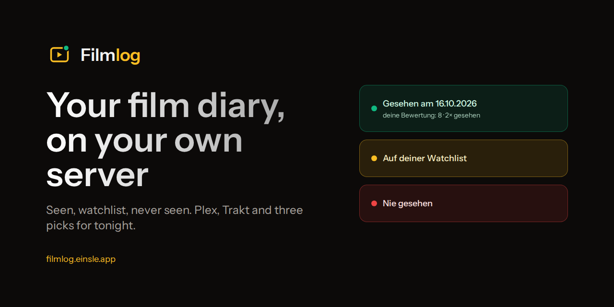

<div align="center">


# Filmlog
### Your film diary, on your own server

[](https://filmlog.einsle.app)
[](https://github.com/roberteinsle/filmlog/wiki)
[](https://github.com/roberteinsle/filmlog/releases)
[](https://github.com/roberteinsle/filmlog/actions/workflows/build.yml)



</div>

---

Filmlog remembers what you watched, how you rated it and what is next on your watchlist, and it answers the question before every movie night: *have I seen this already?* It suggests three unseen films for tonight, fills your diary from Plex, imports your Trakt history and shows where a film is streaming in Germany. One account, your own server, no tracking. The interface is German.

## Installation & quick start

Filmlog ships as a ready Docker image (`ghcr.io/roberteinsle/filmlog`) and needs a PostgreSQL 17 database, a domain, an SMTP account for login links and a free [TMDB API token](https://www.themoviedb.org/settings/api). Any small server that runs Docker is enough; no Redis is needed.

The **[step by step guide in the wiki](https://github.com/roberteinsle/filmlog/wiki/Deployment)** walks you through it:

1. Install **Coolify** (or any Docker host) and point your domain at the server.
2. Create a **PostgreSQL 17** resource and a **Docker Compose** resource with [`deploy/docker-compose.coolify.yml`](deploy/docker-compose.coolify.yml).
3. Set the environment variables, at least `APP_KEY`, `APP_URL`, `FILMLOG_ADMIN_EMAIL`, `TMDB_TOKEN`, `DB_*` and `MAIL_*` ([Configuration](https://github.com/roberteinsle/filmlog/wiki/Configuration)).
4. Log in with a link sent to `FILMLOG_ADMIN_EMAIL`, add a passkey, then optionally upload your Trakt export and connect Plex.

Updates are a new image tag; the database is migrated automatically on start. Make a backup first.

## How it works

Every film carries one of three states, shown as a coloured banner or dot everywhere: **green** for seen, **amber** for your watchlist, **red** for never seen. Viewings store date, rating, companions and a note, so repeat viewings and statistics come for free.

- **Made for the phone:** bottom navigation, dialogs as sheets, works just as well on a desktop.
- **Integrations are optional:** TMDB provides film data; Plex, Trakt and your streaming subscriptions add to it when you want them.
- **Your data stays with you:** single user, passkey login, no analytics, history in your own PostgreSQL.

## Features

| Area | What it does |
|---|---|
| [Status everywhere](https://github.com/roberteinsle/filmlog/wiki/Features#status-at-a-glance) | Seen, watchlist or never seen in search, lists, diary and charts; expand to see and edit every viewing |
| [Heute Abend](https://github.com/roberteinsle/filmlog/wiki/Features#tonight-heute-abend) | Three picks for tonight from the watchlist or Plex library, by companions' age limit, time, mood and subscription |
| [Film pages](https://github.com/roberteinsle/filmlog/wiki/Features#film-page) | Trailer, cast, collection with your status, streaming offers in Germany, your subscriptions and Plex |
| [Lists](https://github.com/roberteinsle/filmlog/wiki/Features#lists-listen) | Watchlist and own lists with drag and drop ranking and combinable filters |
| [Diary](https://github.com/roberteinsle/filmlog/wiki/Features#diary-tagebuch) | Every viewing by month, repeat viewings marked and filterable, edit inline |
| [Review](https://github.com/roberteinsle/filmlog/wiki/Features#review-r%C3%BCckblick) | Year or month: hours, top genres, favourite directors, disagreements with TMDB, unfinished series |
| [Cinema charts](https://github.com/roberteinsle/filmlog/wiki/Cinema-Charts) | German yearly box office charts since 1970, matched to TMDB |
| [Plex](https://github.com/roberteinsle/filmlog/wiki/Plex) | Finished films land in the diary automatically; nightly library sync; selectable Plex Home profiles |
| [Trakt import](https://github.com/roberteinsle/filmlog/wiki/Trakt-Import) | History, ratings, watchlist and lists from a Trakt export, repeatable without duplicates |
| [Streaming](https://github.com/roberteinsle/filmlog/wiki/TMDB-and-Streaming) | Pick your subscriptions once; film pages, suggestions and charts show where you can watch |
| [Security](https://github.com/roberteinsle/filmlog/wiki/Security) | Passkey login, one time login links as fallback, optional authenticator codes |

Everything else, every screen and every setting, is in the **[wiki](https://github.com/roberteinsle/filmlog/wiki)**.

## Privacy & security

Filmlog runs on your server and sends your history to no one. There is no telemetry and no external account; film data is fetched from TMDB. There is exactly one account and no password: you log in with a passkey or a one time link, optionally with an authenticator code.

Every change runs through the full test suite and code style checks before an image is built. Please report vulnerabilities privately as described in [SECURITY.md](SECURITY.md).

## Contributing

Ideas, wishes and bug reports are welcome as an [issue](https://github.com/roberteinsle/filmlog/issues/new).

**For developers:** PHP 8.5, Laravel 13, Livewire 4, Tailwind CSS 4, PostgreSQL 17, tests with Pest. The repository opens ready to use in a dev container or GitHub Codespaces:

```sh
cp .env.example .env              # set TMDB_TOKEN and FILMLOG_ADMIN_EMAIL
docker compose up -d              # app on :8080, worker, scheduler, PostgreSQL
docker compose exec app composer install
docker compose exec app php artisan key:generate
docker compose exec app php artisan migrate
npm install && npm run dev
docker compose exec app php artisan test --compact
```

The login link for local use is written to `storage/logs/laravel.log`. Architecture notes and project rules are in [CLAUDE.md](CLAUDE.md); the full description of every feature is in the [handbook](handbuch), from which the wiki is generated.

## Links

- **Website:** [filmlog.einsle.app](https://filmlog.einsle.app)
- **Wiki:** [Documentation and setup guide](https://github.com/roberteinsle/filmlog/wiki)
- **Versions:** [Releases](https://github.com/roberteinsle/filmlog/releases)

## License

No open source license has been chosen yet, so all rights are reserved for now: you may read the code, but not reuse or redistribute it. Film data and images are provided by [TMDB](https://www.themoviedb.org/); this product uses the TMDB API but is not endorsed or certified by TMDB.
