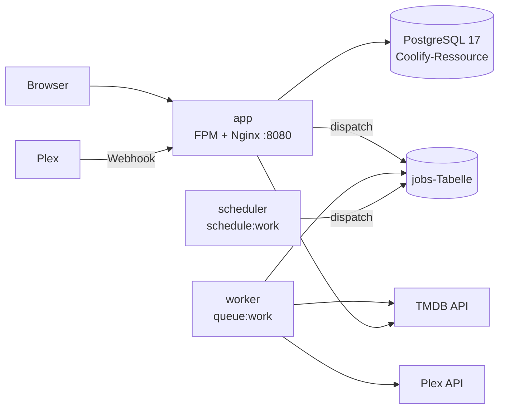

# Filmlog – Projektplan

Stand: 25.10.2026 · Repo: `roberteinsle/Filmlog` (privat) · Ziel-URL: https://filmlog.einsle.cloud

## 1. Entscheidungen

| Thema | Entscheidung |
|---|---|
| Nutzer | Single-User, zugleich Admin: `robert@einsle.com` (`FILMLOG_ADMIN_EMAIL`). Das Konto wird beim ersten Login automatisch angelegt |
| Login | Magic Link per Mail (AWS SES über SMTP): Link 15 Min. gültig und nur einmal verwendbar, Login danach 7 Tage (absolut). Kein Passwort. Alle Routen hinter `auth` außer `/up` und Webhooks |
| Stack | PHP 8.5 · Laravel 13 · Livewire 4 + Blade + Tailwind 4 (Vite) · Drag & Drop mit Livewire-eigenem `wire:sort` · Pest für Tests (gegen Postgres) |
| Datenbank | PostgreSQL 17 als eigene Coolify-Ressource im selben Netz, nicht im Compose-Stack |
| Queue / Cache / Session | Treiber `database`, kein Redis |
| Bewertung | 1–10 **pro Sichtung**; Status-Banner und Filter nutzen die jüngste Bewertung. Tabelle `ratings` entfällt |
| „Mit wem“ | Tabelle `companions` (Jasmin, Familie, …), erweiterbar, Mehrfachauswahl. Keine Auswahl = allein. Jede Begleitung hat optional eine `max_fsk` (z. B. Familie → 12) |
| TMDB | API v4 Read Access Token, `language=de-DE`, `region=DE`, FSK aus `release_dates` (DE), Anbieter aus `watch/providers` (DE) |
| Cache | `movies` um Felder für Filter und Statistik erweitert; Inhalt, Cast, Anbieter und Bilder kommen live (mit kurzem HTTP-Cache) |
| Stimmung | Feste Stimmungen → TMDB-Genres, Zuordnung in `config/filmlog.php` |
| Trakt | Einmaliger ZIP-Upload, Verarbeitung als Job im `worker`, idempotent (zweimal importieren = kein Duplikat) |
| Deploy | `AUTO_DEPLOY=true`: jeder Merge nach `main` und jeder wöchentliche Rebuild geht live |
| Vorgehen | Eine Phase = ein Feature-Branch = ein PR; du prüfst und mergst |
| Doku | Context7-MCP (`.mcp.json`) für aktuelle Laravel-, Livewire- und TMDB-Dokumentation bei der Umsetzung |

## 2. Datenmodell

Basis ist das Modell aus der Projektbeschreibung, erweitert nur dort, wo Filter, Rückblick oder ein idempotenter Import es brauchen.

```
movies            tmdb_id PK, title, original_title, year, runtime, fsk (smallint, null = unbekannt),
                  poster_path, vote_average, vote_count, genre_ids jsonb, directors jsonb [{id,name}],
                  collection_id null, imdb_id null, on_plex bool, plex_rating_key null, cached_at
                  Indizes: GIN(genre_ids), (year), (runtime), (vote_average, vote_count)

collections       id PK (TMDB), name, part_ids jsonb, cached_at        -- für „Lücken“

viewings          id, tmdb_id → movies, watched_at (timestamptz), rating smallint null (1–10),
                  note varchar(280) null, source (manual|trakt|plex), external_id null
                  UNIQUE(source, external_id)                          -- Import-Idempotenz

companions        id, name, max_fsk smallint null, sort
companion_viewing viewing_id, companion_id  PK(beide)

lists             id, name, is_watchlist bool, sort
                  UNIQUE partial index: genau eine Watchlist
list_items        list_id, tmdb_id, rank, added_at  PK(list_id, tmdb_id)

users, sessions, cache, jobs, failed_jobs, job_batches     -- Laravel-Standard
```

Abgeleitete Werte (keine eigenen Spalten): Status des Films (nie gesehen / Watchlist / gesehen + Datum + letzte Bewertung) und die „eigene Bewertung“ für Filter als jüngste `viewings.rating` je Film, umgesetzt als Subquery bzw. Datenbank-View `movie_stats`.

## 3. Architektur



Die drei Container kommen aus demselben Image `ghcr.io/roberteinsle/filmlog`:

- **app:** `AUTORUN_ENABLED=true` (Migrationen und Caches beim Start)
- **worker:** `php artisan queue:work --tries=3 --timeout=120`, `AUTORUN_ENABLED=false`
- **scheduler:** `php artisan schedule:work`, `AUTORUN_ENABLED=false`

Code-Struktur:

- `app/Services/Tmdb/TmdbClient.php`: dünner HTTP-Client (Laravel `Http`, Retry, Rate-Limit)
- `app/Actions/`: `SyncMovie`, `LogViewing`, `ImportTraktExport`, `SuggestForTonight`
- `app/Livewire/`: ein Komponenten-Ordner pro Screen
- `app/Jobs/`: `RefreshMovie`, `ImportTraktZip`, `SyncPlexLibrary`

## 4. Phasen

Jede Phase endet mit grünen Tests, einem PR und nach dem Merge einem automatischen Deploy.

### Phase 0 – Fundament (PR 1)
- `composer create-project laravel/laravel` (Laravel 13), `"php": "^8.5"`, Pest, Livewire, Tailwind
- Infrastruktur-Dateien nach Standard: `Dockerfile` (serversideup `8.5-fpm-nginx-alpine`, `pdo_pgsql intl bcmath`), `.dockerignore`, `.github/workflows/build.yml`, `.devcontainer/devcontainer.json` (PHP 8.5, Node 22, Docker-in-Docker), `docker-compose.yml` (lokal: app + worker + scheduler + Postgres 17), `deploy/docker-compose.coolify.yml` (app, worker, scheduler; **kein** db-Dienst, `DB_HOST` aus Env)
- Login, Layout mit Navigation über die 5 Screens (mobile-first), leere Platzhalter-Seiten
- Login per Magic Link (siehe Entscheidungen), Commit-Hash und -Datum neben dem App-Namen
- Laravel Boost (Guidelines + Skills für Agents, ohne MCP)
- `config/filmlog.php` (Stimmungen, Region, TMDB-Mindeststimmen = 500)
- **Deine Schritte danach:** siehe Abschnitt 6. Ergebnis: `/up` liefert 200 auf filmlog.einsle.cloud

### Phase 1 – TMDB, Suche, Filmseite, Status-Banner (MVP)
- Schema aus Abschnitt 2 für `movies`, `viewings`, `lists` (Watchlist wird per Migration angelegt) und `list_items`; `companions` folgt in Phase 2
- `TmdbClient` + `SyncMovie` (Details mit `append_to_response=release_dates,credits,watch/providers`), FSK-Extraktion DE
- Suche (Livewire, debounced, `de-DE`) mit Status-Punkt pro Treffer
- Filmseite: Banner 🟢/🟡/🔴, Poster, Inhalt, Laufzeit, FSK, Cast, Regie, Streaming-Anbieter DE; „Auf Plex vorhanden“ folgt in Phase 7
- Tests mit `Http::fake()` und gespeicherten TMDB-Antworten als Fixtures

### Phase 2 – Sichtungen, Bewertung, Tagebuch (MVP)
- „Gesehen“-Dialog auf der Filmseite: Datum (Default heute), Bewertung 1–10, Begleitung (Mehrfachauswahl), Notiz (ein Satz)
- Beim Speichern als gesehen fragt Filmlog, ob der Film von der Watchlist entfernt werden soll
- Tagebuch: chronologische Timeline, gruppiert nach Monat, Mehrfachsichtungen markiert („2. Sichtung“), bearbeiten und löschen
- Einstellungen: Begleitungen verwalten (Name, max. FSK, Reihenfolge)

### Phase 3 – Watchlist, eigene Listen, Filter (MVP)
- Watchlist mit Rang per Drag & Drop (`wire:sort`), eigene Listen anlegen, umbenennen, löschen
- Filterleiste, kombinierbar und in der URL gespeichert: eigene Bewertung ≥ X · TMDB ≥ X (nur ab 500 Stimmen) · Genre · Jahrzehnt · Laufzeit · FSK
- „Zur Liste hinzufügen“ von Filmseite und Suche

### Phase 4 – Trakt-Import (MVP)
- Upload-Seite → ZIP in `storage/app/imports` → Job `ImportTraktZip` im worker, Fortschritt per Polling
- Liest `watched-history` → viewings (`source=trakt`, `external_id` = Trakt-History-ID), `ratings-movies` → Bewertung der jeweils letzten Sichtung, `watchlist` → Watchlist, `lists-*` → Listen
- Filme ohne `tmdb_id` werden über `imdb_id` per TMDB `/find` aufgelöst; was sich nicht auflösen lässt, landet in einem Import-Bericht
- **Von dir benötigt:** die Dateiliste deines ZIPs (nur die Namen und einen gekürzten, anonymisierten Eintrag, damit ich das Format treffe)
- Umgesetzt gegen das Trakt-API-JSON-Format (`watched-history.json` bzw. `history*.json`, `ratings-movies.json`, `watchlist.json`, `lists-lists.json` + `lists-{slug}.json`, Ordner im ZIP egal). Nicht erkannte Dateien nennt der Import-Bericht; weicht dein Export ab, wird der Parser angepasst

### Phase 5 – Scheduler und MVP-Release
- Nächtlich (03:30): `RefreshMovie` für Filme mit `cached_at` älter als 30 Tage sowie für Filme auf Listen (Anbieter ändern sich)
- `queue:prune-failed`, Bereinigung alter Import-Dateien
- **Release v0.1.0**: MVP komplett

### Phase 6 – Heute-Abend-Assistent (Kür)
- Drei Fragen: Mit wem (Begleitung → max. FSK), wie viel Zeit (z. B. < 100 / < 130 / egal), Stimmung (→ Genres)
- Kandidaten aus Watchlist ∪ Plex-Bestand, ohne bereits Gesehenes. Sortierung: Watchlist-Rang, dann TMDB-Bewertung, mit leichtem Zufall. Ergebnis: 3 Vorschläge, „Andere Vorschläge“ würfelt neu
- „Läuft gerade“: legt eine Sichtung von heute an und öffnet danach den Bewertungsdialog

### Phase 7 – Rückblick (Kür)
- Monats- und Jahresstatistik: Anzahl Filme, Stunden, Top-Genres, Lieblingsregisseure (nach Anzahl und Ø-Bewertung)
- „Gegen den Strom“: größte |eigene Bewertung − TMDB-Bewertung|
- „Lücken“: `collections`, in denen ≥ 1, aber nicht alle bereits erschienenen Teile gesehen sind

### Phase 8 – Plex (Kür)
- Plex-Webhook `POST /webhooks/plex/{secret}` (geheimer Pfad-Token aus der Env), Event `media.scrobble` → Sichtung (`source=plex`), Zuordnung über die GUIDs `tmdb://` / `imdb://`
- Nächtlicher Bestandsabgleich der Plex-Filmbibliothek → `movies.on_plex`
- ~~Radarr: neuer Watchlist-Eintrag → Job `PushToRadarr`~~ – aktuell out of scope (Entscheidung vom 26.10.2026)

## 5. Credentials – nie im Repo

| Variable | Wo sie liegt |
|---|---|
| `APP_KEY` | Coolify-Env (lokal: `.env`, gitignored) |
| `DB_HOST`, `DB_DATABASE`, `DB_USERNAME`, `DB_PASSWORD` | Coolify-Env |
| `TMDB_TOKEN` | Coolify-Env, lokal `.env` |
| `MAIL_USERNAME`, `MAIL_PASSWORD` (SES-SMTP-Credentials), `MAIL_FROM_ADDRESS`, ggf. `MAIL_HOST` | Coolify-Env |
| `PLEX_WEBHOOK_SECRET`, `PLEX_URL`, `PLEX_TOKEN` | Coolify-Env (ab Phase 8) |
| `COOLIFY_TOKEN`, `COOLIFY_WEBHOOK` | GitHub Repository-Secrets |
| GHCR-PAT `read:packages` | nur in `/root/.docker/config.json` auf dem Coolify-Server |

Absicherung: `.env*` in `.gitignore` und `.dockerignore`, im Repo nur `.env.example` mit leeren Werten. Zusätzlich GitHub Secret Scanning und Push Protection im Repo aktivieren.

## 6. Deine einmaligen Schritte (nach Phase 0)

1. GitHub: Repo privat lassen, Secret Scanning und Push Protection aktivieren, Variable `AUTO_DEPLOY=true` setzen
2. Coolify-Server: `docker login ghcr.io -u roberteinsle` mit dem PAT `read:packages` (falls noch nicht geschehen)
3. Coolify: Postgres-17-Ressource anlegen (DB `filmlog`, eigener User), Backup täglich einschalten. `DB_HOST` = interner Hostname der Postgres-Ressource; das Compose hängt die Dienste dafür ins externe Netz `coolify`
4. Coolify: Docker Compose Empty anlegen, `deploy/docker-compose.coolify.yml` einfügen, Env-Variablen setzen, Domain `https://filmlog.einsle.cloud` → Port 8080 am Dienst `app`
5. DNS: `filmlog.einsle.cloud` auf den Coolify-Server (entfällt bei Wildcard)
6. Secrets `COOLIFY_TOKEN` und `COOLIFY_WEBHOOK` im Repo hinterlegen
7. Erstes Deploy, `php -v` im Container (≥ 8.5.12), danach per Magic Link mit `robert@einsle.com` anmelden

## 7. Hinweise zur Vorlage „Tech Stack“

Diese Punkte übernehme ich bewusst korrigiert:

- In der eingefügten Vorlage sind Teile von `Dockerfile`, `build.yml` und Coolify-Compose zerschossen: `${…}`-Ausdrücke fehlen, Zeilen sind zusammengezogen. Ich schreibe sie sinngemäß korrekt neu.
- Die Vorlage nennt die Repo-Variable einmal `AUTO_DEPLOY` und einmal `AUTODEPLOY`. Ich verwende durchgängig `AUTO_DEPLOY`.
- Das Coolify-Compose der Vorlage enthält einen `db`-Dienst und keinen Scheduler. Für Filmlog entfällt `db` (die Datenbank ist extern), und `scheduler` kommt dazu. `depends_on: db` entfällt entsprechend.
- In `build.yml` läuft vor dem Image-Build ein Test-Job (Pint + Pest gegen einen Postgres-Service). Ein roter Test erzeugt kein neues `latest`; Pull Requests werden nur getestet, nicht gebaut.
- Die Vorlage ruft den Coolify-Deploy per `GET` auf. Coolify v4.5 verlangt `POST` (GET liefert 405); `build.yml` nutzt deshalb POST.
- Die Vorlage sieht Filament vor. Filmlog verzichtet bewusst darauf (Endnutzer-App, Livewire-Screens).

## 8. Risiken und offene Punkte

- **Trakt-Format:** Je nach Exportweg (offizieller Export oder Community-Tool) unterscheiden sich die Dateinamen. Klärung zu Beginn von Phase 4.
- **FSK-Lücken bei TMDB:** Ältere Filme haben teils keine DE-Freigabe. Sie gelten dann als „FSK unbekannt“, und der Assistent schließt sie bei gesetzter `max_fsk` aus.
- **TMDB-Rate-Limit** (ca. 50 Requests/s) beim Trakt-Import: Der Job drosselt und wiederholt bei 429.
- **Plex-Webhooks** brauchen Plex Pass.
- **Codespace:** Der aktuelle Codespace läuft noch mit PHP 8.4.15 und wurde nicht aus `.devcontainer/` erzeugt. Nach dem Merge von Phase 0 den Codespace neu erstellen (Rebuild Container), dann gilt PHP 8.5. Bis dahin laufen PHP-Befehle im Container `serversideup/php:8.5-cli-alpine`. Außerdem ist im aktuellen Codespace die Verbindung zwischen Containern auf der Docker-Bridge gestört; lokal getestet wurde deshalb mit dem Host-Netz.
